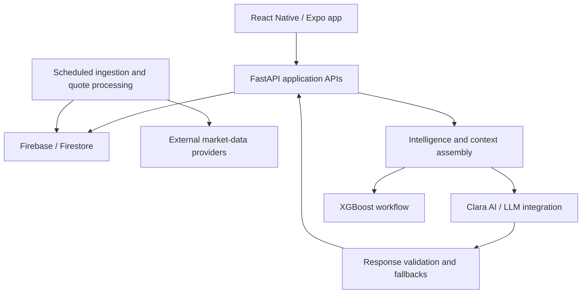

# Alphaclara
### AI-powered market intelligence

A production iOS application built by [Ramesh Pingili](https://github.com/rameshpingili1729).

[Website](https://alphaclara.ai) · [Download on the App Store](https://apps.apple.com/us/app/alphaclara/id6766338219)

## My role
Founder & AI Solutions Architect | 2025–present

I designed and shipped Alphaclara using Python, FastAPI, React Native, Expo, and Firebase/Firestore. I own architecture, integration, testing, deployment, monitoring, and production troubleshooting.

## Engineering highlights

- Integrated Clara AI with structured application and market context.
- Built response validation and deterministic fallbacks for AI responses.
- Implemented scheduled ingestion, quote processing, caching, and retries.
- Built circuit breakers to handle external service failures.
- Developed an XGBoost workflow using 48 engineered features.

## Technology

| Layer | Technologies |
| --- | --- |
| Mobile | React Native, Expo |
| Backend | Python, FastAPI, REST APIs |
| Persistence | Firebase, Firestore |
| Intelligence | LLM integration, structured context, XGBoost |
| Quality & reliability | Response validation, fallbacks, caching, retries, circuit breakers, monitoring |

## Engineering approach

I use coding agents for implementation, debugging, and review while owning architectural decisions. I validate generated changes against requirements, existing data, integration behavior, and actual user flows.

## Repository scope

This repository is a public product and engineering showcase. It does not contain the commercial application's source code, credentials, or user data.

[Professional profile](https://github.com/rameshpingili1729) · [LinkedIn](https://www.linkedin.com/in/rameshpingili)

## Architecture overview

This simplified view describes responsibilities across the product; it is not a deployment diagram or a complete service inventory.

## Responsibilities and tradeoffs

| Area | Engineering responsibility | Why it matters |
| --- | --- | --- |
| Mobile API boundary | Connect screen needs to backend responses | Keeps UI integration understandable and testable |
| Data ingestion | Schedule processing and persist updates | Separates provider interaction from screen rendering |
| Quote processing | Coordinate caching and persistence | Requires attention to freshness as well as responsiveness |
| Clara AI | Assemble structured application and market context | Gives the conversational layer relevant information |
| AI output handling | Validate responses and provide deterministic fallbacks | Helps the application handle unreliable model output |
| External services | Use retries and circuit breakers | Bounds the effect of provider failures |
| Market intelligence | Connect a 48-feature XGBoost workflow to app experiences | Turns model output into a usable product capability |

## Validation and review

I review changes across mobile behavior, API contracts, provider interactions, persistence, and AI response handling. My work includes API testing, regression testing, production smoke tests, monitoring, and root-cause analysis.

Questions I use when reviewing changes in this area:

- Does a quote represent fresh data, and does the UI communicate its state accurately?
- What happens when a provider times out or returns an incomplete response?
- Does a cached value preserve the behavior the screen promises?
- Does an AI response follow the expected structure, and is fallback behavior usable?
- Do tests verify user-visible behavior without weakening the original requirement?
- Can the failure be traced to a specific request, response, processing step, or stored record?

These questions describe my review approach, not a claim that this showcase contains an executable test suite.

## Portfolio evidence

The public website and App Store listing demonstrate the shipped product. This repository documents my role, technical responsibilities, and design approach. It does not publish source code, internal logs, measured model accuracy, or a reproducible benchmark.
